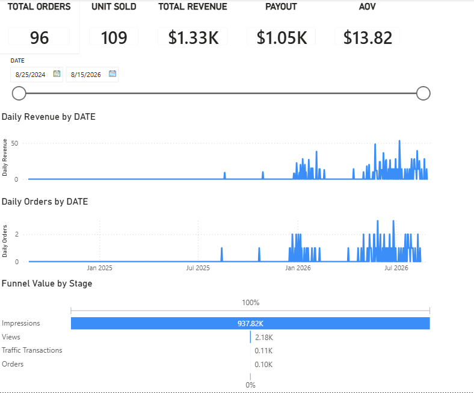
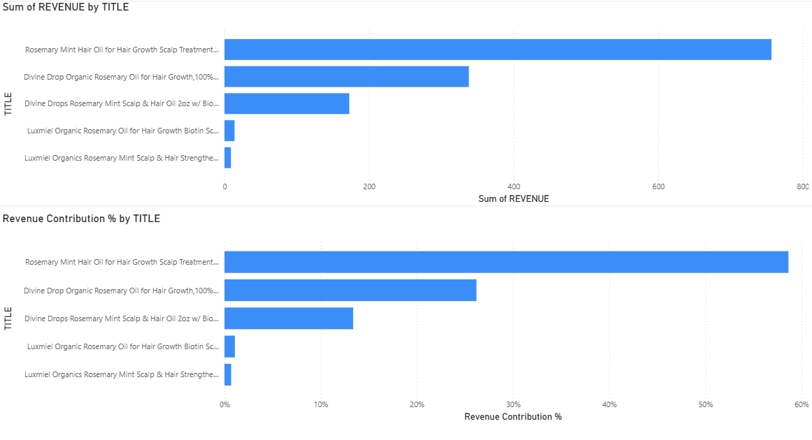
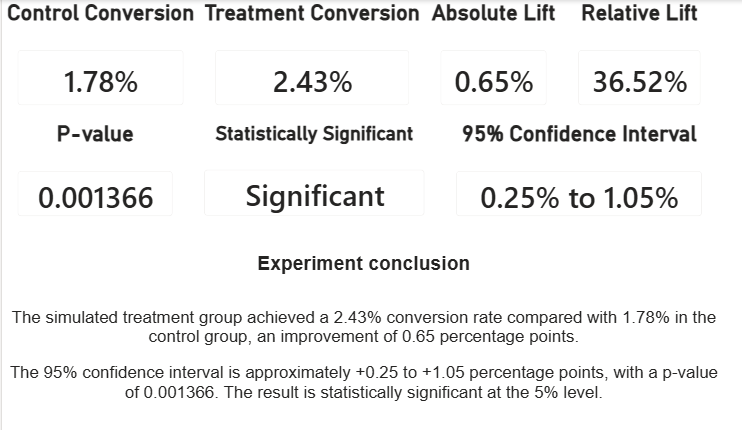

# eBay Seller Analytics & Experimentation Platform

An end-to-end e-commerce analytics project built around real eBay seller
data. The platform combines eBay API integration, Python, FastAPI,
Snowflake, dbt, SQL, statistical analysis, and Power BI to turn
marketplace data into business insights.

**Portfolio project:** [GitHub
repository](https://github.com/ahmedkhalidse8/ebay-api-project) ·
[Portfolio](https://ahmedkhalidse8.github.io/)

------------------------------------------------------------------------

## Project overview

The objective is to understand seller performance, identify
opportunities across traffic, sales, and products, and demonstrate how a
business intervention could be evaluated using statistical methods.

The project covers:

-   Sales, orders, revenue, and seller proceeds
-   Listing traffic and funnel performance
-   Product-level performance
-   Buyer and repeat-purchase analysis
-   Real-world listing performance comparison
-   Synthetic controlled-experiment demonstration
-   Statistical hypothesis testing
-   Data transformation, validation, and Power BI reporting

The project deliberately distinguishes actual eBay observations from
synthetic experiment data. Historical listing comparisons are not
presented as randomized A/B tests.

## Dashboard

The Power BI report contains three pages:

1.  **Executive Overview** --- headline business and performance
    metrics.
2.  **Product Analysis** --- product-level sales and performance.
3.  **Experimentation** --- control/treatment conversion metrics and
    statistical results from the synthetic demonstration.

> Add the three screenshots to `docs/images/` using the filenames below.
> The image references are already prepared for those files.

### Executive Overview



### Product Analysis



### Experimentation



The editable Power BI report is available at
[`Power BI/ebay_analytics_dashboard.pbix`](Power%20BI/ebay_analytics_dashboard.pbix).

## Technology stack

  Area                        Technology
  --------------------------- ------------------------------
  Data source                 eBay Sell and Analytics APIs
  API application             FastAPI
  Deployment                  Vercel
  Extraction and processing   Python, Pandas
  Statistical analysis        Python, NumPy, SciPy
  Data warehouse              Snowflake
  Transformation              dbt
  Business analysis           SQL
  Visualization               Power BI
  Version control             Git, GitHub

## Architecture

``` text
                    eBay APIs
                        |
                 OAuth authentication
                        |
                 FastAPI application
                        |
                  Vercel deployment
                        |
                Python extraction
                        |
                 Raw JSON responses
                        |
              Python transformation
                        |
                 Processed CSV files
                        |
                 Snowflake RAW layer
                        |
                    dbt models
                        |
              Analytical facts and marts
                        |
                 SQL / Python analysis
                        |
                  Power BI report
                        |
                 Business insights
```

The Python outputs also support local analysis and the statistical
demonstration. The Snowflake/dbt warehouse work was implemented during
the Snowflake trial period. The trial has since expired, so the
warehouse cannot currently be rerun without reactivating paid access.
Existing project files and completed implementation are retained; this
README does not claim a fresh warehouse or dbt test run.

## Data and analytical scope

### eBay data

The project extracts and processes traffic, order, and inventory
information exposed by the connected eBay APIs.

  -----------------------------------------------------------------------
  Dataset                 Available project data  Notes
  ----------------------- ----------------------- -----------------------
  Listing traffic         723 daily records,      Historical daily
                          2024-08-25 to           traffic extraction
                          2026-08-15

  Orders                  96 processed records,   Five products
                          96 unique orders        represented

  Inventory               One API-returned item   Auxiliary dataset;
                                                  coverage is limited by
                                                  the API response

  Buyer analysis          88 unique buyers        Aggregate buyer metrics
                                                  are published;
                                                  buyer-level records are
                                                  excluded
  -----------------------------------------------------------------------

Traffic transactions and order records are different measures. They are
not treated as interchangeable.

### Buyer analysis

The available processed order data produced the following buyer metrics:

  Metric                        Result
  --------------------------- --------
  Unique buyers                     88
  Repeat buyers                      4
  One-time buyers                   84
  Repeat-buyer rate              4.55%
  Orders from repeat buyers         12

The analysis is limited to the buyer and order information available in
the processed dataset. It does not claim cohort retention, customer
lifetime value, or other unsupported customer metrics. Buyer-level
records are kept out of the public repository; only aggregate metrics
are published.

## Python extraction and processing

The API and Python components support:

-   OAuth authentication and access-token handling
-   API requests through the FastAPI application
-   Traffic, order, and inventory extraction
-   Raw JSON response storage
-   Transformation into processed CSV datasets
-   Buyer and product summaries
-   Listing-level traffic comparison
-   Statistical experiment demonstration

Raw API responses, credentials, tokens, and private buyer-level files
are excluded from the public repository.

## Snowflake and dbt

The warehouse implementation uses the `ECOMMERCE_ANALYTICS` database,
with raw source data separated from downstream analytical models.

The dbt project is organized into the following layers.

**Staging** - `stg_traffic` - `stg_orders` - `stg_inventory`

**Intermediate** - `int_order_metrics`

**Analytical models** - `fct_orders` - `mart_daily_performance` -
`mart_product_performance`

The practical order model uses a line-item grain: one row represents one
line item within an eBay order. Daily traffic and product performance
are represented through their respective analytical models.

The repository includes dbt model configuration and schema tests. The
Snowflake trial has expired, so fresh dbt execution and test results are
currently unavailable. The models and test definitions are preserved as
implemented; they should not be interpreted as a newly passing
production run.

## SQL business analysis

The SQL files in `ebay_analytics/sql/` cover:

-   **Sales analysis:** revenue, orders, units, seller proceeds, average
    order value, and monthly performance.
-   **Traffic analysis:** impressions, views, transactions, and traffic
    trends.
-   **Product analysis:** product sales, units, orders, and revenue
    contribution.
-   **Funnel analysis:** impressions to views, views to transactions,
    and comparisons with order activity.
-   **Validation:** record counts, date ranges, duplicate checks, and
    analytical data checks.

The analysis uses the available source definitions and preserves the
distinction between eBay traffic transactions and processed orders.

## Real-world listing performance comparison

A separate analysis compares actual listing-level traffic data for two
eBay listings over **July 31 to October 28, 2026**.

  Metric                                 Listing A        Listing B
  ------------------------------- ---------------- ----------------
  Item ID                           `227307906290`   `226991664030`
  Impressions                               28,577          459,421
  Views                                         54              930
  Transactions                                   3               23
  Views / impressions                       0.189%           0.202%
  eBay-reported conversion rate               5.0%             2.0%

**Findings**

-   Listing B received approximately 16.1 times as many impressions and
    generated more views and transactions during the observation period.
-   Listing A had a higher eBay-reported conversion rate, but that rate
    was based on only 54 views and three transactions.
-   The views-to-impressions ratios were similar.

These are descriptive observations, not evidence that one image caused
better performance. The listings also had different titles, and price,
promotions, listing age, search placement, and exposure may affect the
results. This comparison is not a randomized controlled experiment.

## Statistical experiment demonstration

The project includes a separate synthetic experiment in
`src/analyze_experiment.py`. It demonstrates a two-proportion
conversion-rate test using simulated control and treatment groups.

  -----------------------------------------------------------------------
  Metric                                                           Result
  ------------------------------ ----------------------------------------
  Visitors per group                                               10,000

  Control conversions                                                 178

  Treatment conversions                                               243

  Control conversion rate                                           1.78%

  Treatment conversion rate                                         2.43%

  Absolute lift                                   +0.65 percentage points

  Relative lift                                                   +36.52%

  p-value                                                         0.00137

  95% confidence interval for            +0.25 to +1.05 percentage points
  absolute lift

  Significant at 5% level                                             Yes
  -----------------------------------------------------------------------

The script uses a two-sided pooled two-proportion z-test and an
approximate Wald confidence interval. The simulated results are for
demonstrating statistical methodology only. They are not actual eBay
results, are not derived from the two-listing comparison, and do not
establish that a real listing change caused an improvement.

A real experiment would require controlled assignment, a pre-defined
hypothesis and metric, suitable sample size, and consistent event-level
measurement.

## Repository structure

``` text
ebay-api-project/
├── app.py
├── requirements.txt
├── .gitignore
├── README.md
├── src/
│   ├── extract.py
│   ├── transform.py
│   ├── analyze.py
│   ├── load.py
│   ├── inspect_orders.py
│   ├── analyze_listing_comparison.py
│   └── analyze_experiment.py
├── ebay_analytics/
│   ├── dbt_project.yml
│   ├── models/
│   │   ├── schema.yml
│   │   ├── staging/
│   │   ├── intermediate/
│   │   └── marts/
│   └── sql/
├── processed/
│   ├── buyer_metrics.csv
│   ├── daily_sales.csv
│   ├── product_performance.csv
│   ├── traffic_analysis.csv
│   ├── listing_image_comparison.csv
│   └── experiment_results.csv
├── docs/
│   └── images/
│       ├── executive-overview.png
│       ├── product-analysis.png
│       └── experimentation.png
└── Power BI/
    └── ebay_analytics_dashboard.pbix
```

Raw API data, private buyer-level analysis, local environment files,
credentials, and other development artifacts are intentionally excluded.

## Running the analysis

Run commands from the repository root using the project's virtual
environment. For example:

``` powershell
.\.venv\Scripts\python.exe src\analyze_listing_comparison.py
.\.venv\Scripts\python.exe src\analyze_experiment.py
```

The listing comparison requires its locally stored raw listing-traffic
input. The experiment script generates synthetic data and its aggregate
result file. API extraction requires valid eBay credentials and
permissions. Warehouse operations require an active Snowflake account
and configured connection.

## Limitations and analytical safeguards

-   API availability and returned fields depend on eBay permissions and
    endpoint support.
-   Inventory coverage is limited to the item returned by the connected
    Inventory API.
-   Traffic transactions and order records have different definitions.
-   Historical listing comparisons do not isolate causal effects.
-   Small conversion samples can produce unstable rates.
-   The statistical experiment is synthetic, not a live eBay experiment.
-   The synthetic experiment uses aggregate counts rather than a real
    event-level experiment dataset.
-   Buyer analysis is limited to available order data; unsupported
    retention and lifetime-value metrics are not fabricated.
-   Warehouse and dbt execution cannot currently be rerun because the
    Snowflake trial has expired.
-   Revenue analysis must respect order-line grain and avoid
    double-counting order-level totals.
-   Credentials, tokens, raw customer records, and private configuration
    must not be committed.

## Project status

  -----------------------------------------------------------------------
  Component                           Status
  ----------------------------------- -----------------------------------
  eBay API, OAuth, FastAPI, and       Implemented
  Vercel integration

  Python extraction and processing    Implemented

  Snowflake warehouse design and      Implemented during trial; current
  loading work                        trial expired

  dbt staging, intermediate, and mart Implemented; fresh execution
  models                              unavailable

  SQL business analysis               Implemented

  Buyer and product analysis          Implemented

  Real-world listing comparison       Implemented

  Synthetic statistical demonstration Implemented

  Three-page Power BI dashboard       Completed

  Public documentation and            Final repository publishing step
  screenshots
  -----------------------------------------------------------------------

## Author

**Ahmed Khalid**\
Data Analyst \| SQL, Python, Power BI \| E-commerce & Business Analytics

-   [GitHub](https://github.com/ahmedkhalidse8)
-   [Portfolio](https://ahmedkhalidse8.github.io/)
